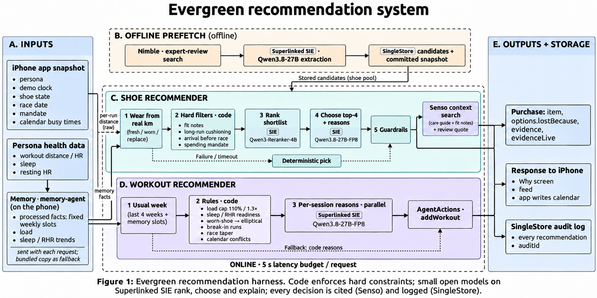

# Evergreen

**A personal agent that makes sure your workout happens.**

> Google and Apple coach your workout. We make sure it happens.

Evergreen is an iOS agent that protects your workout plan instead of just writing one. It picks workouts for your body and the time you actually have, moves a workout when a meeting lands on it, finds what your training needs (a rainy-day gym pass, new running shoes) and buys it only after you say yes, and shows its reasoning for every action. Built for the [Personal Agents Hackathon](https://luma.com/personalagenthack) (San Francisco, November 2026).

## Demo


https://github.com/user-attachments/assets/9d3cc401-fd6f-40d0-a5ab-5fae2b718493




## Contents

- [What it does](#what-it-does)
- [Architecture](#architecture)
- [Repository layout](#repository-layout)
- [Quick start](#quick-start)
- [The harness API](#the-harness-api)
- [Sponsors and tools](#sponsors-and-tools)
- [Demo](#demo)
- [Design principles](#design-principles)
- [Status and roadmap](#status-and-roadmap)
- [Team](#team)

## What it does

| | |
|---|---|
| **Fits your real week** | Reads Apple Health and your calendar, then picks the week's workouts for the time you actually have: an easy Friday run because your load is up 19%, the long run in your open Saturday morning. |
| **Defends the slot** | A meeting lands on tonight's run. The agent moves it to your next open time (or shortens it), sends a notification and says why, with Undo and "Pick another time". |
| **Shops with an audit trail** | Your shoes hit 390 miles nine days before your race. The agent researches real shoes on the web, picks one for how you train, explains why every other option lost, cites its sources, and waits for your OK. Nothing is bought without a yes: a $15 rainy-day gym pass asks first too, and cancels itself if the forecast clears. |
| **Checks age, privately** | Before the agent can buy anything, the person passes a Persona age check (18+). Only a yes/no claim comes back: no name, birthdate or ID. Built in the harness; the app doesn't open Persona's flow yet. |
| **Plans the next 7 days** (harness) | The next 7 days come from your usual routine and memory, adjusted for training load, sleep and resting heart rate, worn shoes, a race taper and your calendar. Optional extras from expert guidance are suggested, never forced. The app doesn't call this route yet. |
| **Remembers you** | A memory layer turns health data into exact facts ("runs Tue 18:00 in 3 of the last 4 weeks", "load 1.14× the 4-week average") that shape every plan. |
| **Shows its work** | Every action has a reason, every recommendation has citations, and every decision is logged as an audit record. |

No real money moves: every checkout is a clearly labeled demo store. All health data is synthetic.

## Architecture

```
┌──────────────── iPhone app (SwiftUI) — the hands ────────────────┐
│ Health + calendar snapshot · memory · demo controls              │
│ Today card · Why screen · checkout · its own calendar            │
│ notifications · pine buddy · Undo / Order it / Not now           │
└───────────────┬───────────────────────────────▲──────────────────┘
                │ POST /shoes/recommend         │ Purchase, AgentActions,
                │ POST /workouts/recommend      │ reasons, citations, auditId
┌───────────────▼───────────────────────────────┴──────────────────┐
│ Harness (Python, FastAPI on Vercel) — the brain, stateless       │
│  code: hard rules (fit, load cap, readiness, taper, mandate)     │
│  Superlinked SIE: rerank + small open models choose and explain  │
│  Senso: cited knowledge · Nimble: web research (prefetched)      │
│  SingleStore: shoe candidates + audit log                        │
│  Persona Relay: 18+ age check before any purchase                │
└──────────────────────────────────────────────────────────────────┘
        memory-agent (JS): daily facts from health data → planner
```

The phone keeps the memory and does every write (calendar, notifications, the pretend order). The harness decides and explains, and stores nothing between calls except its audit log and each person's age-check claim (yes/no). Each recommendation answers within a 5-second budget and falls back to a deterministic answer if a model or service is slow, so the demo never depends on a live call.

## Repository layout

| Path | What's there |
|---|---|
| [`app/`](app/) | The iOS app: SwiftUI + SwiftData, iOS 18+, Swift 6. Agent stand-in, calendar sync, slot defense, the shopping beat, notifications, the pine buddy. [README](app/README.md) |
| [`harness/`](harness/) | The recommendation backend: shoe and workout recommenders, web research, Senso evidence, SingleStore audit log. [README](harness/README.md) · [app integration](harness/INTEGRATION.md) |
| [`memory-agent/`](memory-agent/) | The memory layer: facts from health snapshots and feedback, Amplitude events. Runs in iOS JavaScriptCore; Node for tests. [README](memory-agent/README.md) |
| [`MockData/`](MockData/) | Synthetic Apple Health exports for three personas: Sam (inactive), Alex (moderate), Jordan (half-marathon training). The app demos Jordan. |
| [`docs/designs/`](docs/designs/) | Design docs: the [main plan](docs/designs/evergreen-hackathon.md), the [shopping beat](docs/designs/evergreen-shopping-beat.md), the [recommendation harness](docs/designs/evergreen-recommendation-harness.md). |
| [`docs/figures/`](docs/figures/) | The system figure above. |
| [`demo-video/`](demo-video/) | Screen recordings of each demo beat. |
| [`DESIGN.md`](DESIGN.md) | The design system: colors, type, spacing, components. |

## Quick start

### iOS app

Requires Xcode 26 and an iPhone simulator (or a phone with a development team).

```sh
open app/Evergreen.xcodeproj      # then Run
```

Demo controls are on by default in Debug builds (the floating button). See [app/README.md](app/README.md) for the demo beats.

### Harness

Requires [uv](https://docs.astral.sh/uv/).

```sh
cd harness
uv sync
cp .env.example .env          # add your keys (see below)
uv run pytest -q              # 36 tests
PYTHONPATH=. uv run uvicorn api.index:app --port 8000
```

| Variable | Needed for |
|---|---|
| `SUPERLINKED_API_KEY` | Ranking, choosing and explaining (SIE Serverless) |
| `SENSO_API_KEY` | Live citations (falls back to cached passages) |
| `NIMBLE_API_KEY` | Web research, only for the prefetch scripts |
| `SINGLESTORE_URL` | Candidate store and audit log (optional) |
| `HARNESS_SECRET` | Protects the paid routes (`X-Harness-Secret` header) |
| `PERSONA_API_KEY` | The 18+ age check before purchases (Persona Relay; a key with `privacy_pass.write` is enough, a `persona_sandbox_` key always passes). `PURCHASE_REQUIRES_AGE_CHECK=0` turns the gate off (optional) |

Deployed at `https://trackerplusplus-harness.vercel.app`. Deploy with `npx vercel deploy --prod --yes` from `harness/`.

### Memory agent

Requires Node 20+.

```sh
cd memory-agent
node scripts/demo.mjs half_marathon
npm install && npm test
```

## The harness API

| Route | Secret | What it returns |
|---|---|---|
| `GET /health` | | Which services are configured |
| `POST /warm` | ✓ | Loads the SIE models and SingleStore candidates. Run before a demo. |
| `POST /shoes/recommend` | ✓ | Shoe condition + a `Purchase`: the pick, every option with why it lost, citations, photos, the age-check state (`identity`), `auditId` |
| `POST /workouts/recommend` | ✓ | The next 7 days as calendar-ready actions, with reasons, citations, optional suggestions, `auditId` |
| `POST /evidence` | | Cited passages for a purchase (Senso) |
| `POST /shoes/prefetch` | ✓ | Re-runs the web research into SingleStore |
| `GET /audit/recent`, `GET /audit/{id}` | ✓ | The audit trail |
| `POST /verify/start` | ✓ | Starts a Persona age check: a `sessionToken` for the app to open Persona's flow (the relay secret stays on the server) |
| `POST /verify/check` | ✓ | After the flow: redeems the Privacy Pass token and stores the yes/no claim |
| `GET /verify/status` | ✓ | Whether the person is verified, and how |

```sh
curl -s https://trackerplusplus-harness.vercel.app/shoes/recommend \
  -H 'content-type: application/json' -H "X-Harness-Secret: $SECRET" \
  -d '{"persona":"jordan","now":"2026-11-20T09:00:00-08:00",
       "shoes":{"boughtOn":"2026-10-22","startMiles":267},"raceDate":"2026-11-29","mandate":[]}'
```

Full request and response shapes are in [harness/README.md](harness/README.md); wiring them into the app is in [harness/INTEGRATION.md](harness/INTEGRATION.md).

## Sponsors and tools

| | Used for |
|---|---|
| **[Superlinked](https://superlinked.com)** | SIE Serverless: `Qwen3-Reranker-4B` ranks shoe shortlists; `Qwen3.8-27B-FP8` extracts shoes and workout ideas from the web, picks a shoe and writes every reason |
| **[Senso](https://senso.ai)** | Knowledge base and context search: the citations on the Why screen |
| **[SingleStore](https://singlestore.com)** | Web shoe candidates and a permanent audit record of every recommendation |
| **[Amplitude](https://amplitude.com)** | Recommendation and workout events from the memory agent |
| **[Persona](https://withpersona.com)** | Relay: an 18+ age check over Privacy Pass that unlocks purchases; only the yes/no claim is stored |
| [Nimble](https://nimbleway.com) | Web search of expert reviews and training guidance |
